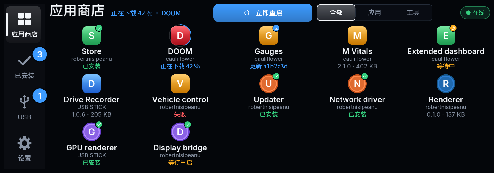
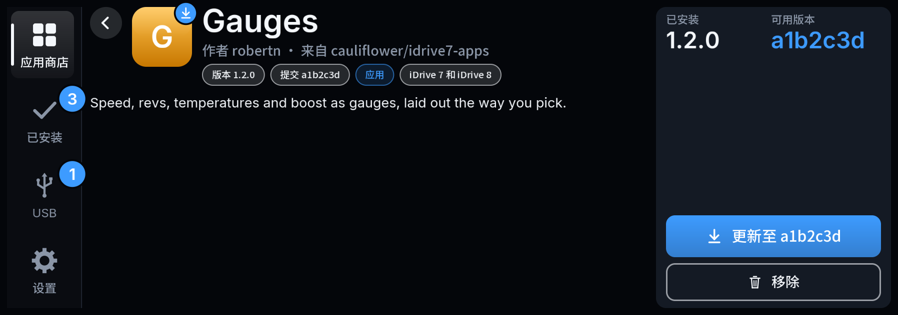
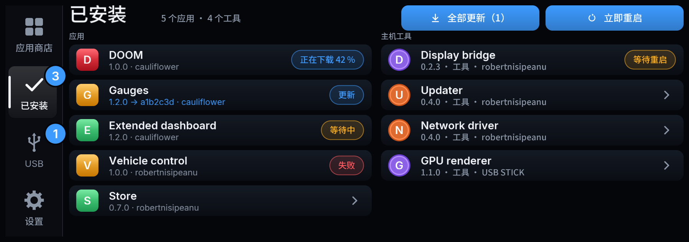

# mgu-store-cn

[English](README.md) | 简体中文

**开发预览：目前没有可上车的 CN 正式安装版本。**

本项目基于 [robertnisipeanu/mgu-store](https://github.com/robertnisipeanu/mgu-store)，
保留原组件身份，提供独立的国内更新通道。已有中文 README 和代码渲染截图来自维护者的
中文文档贡献；当前上游已包含简体中文，不重复移植过期汉化补丁。
来源迁移、自更新和组件更新顺序仍需车机集成验收，详见 [国内发行版说明](docs/CN-DISTRIBUTION.md)。

适用于宝马 iDrive 7 和 iDrive 8 车机（MGU）的应用商店。可以直接在车机屏幕上，
浏览、安装、更新和移除来自国内 HTTPS 目录或 U 盘的应用。国内版不提供 GitHub
登录、令牌或 GitHub 仓库来源功能。

安装内容包括：

- **应用商店**：车机上的商店应用；
- **更新器**：按商店的请求下载和安装组件；
- **部署工具**：执行安装，并支持回滚；
- **应用隐私**：防止已安装的应用出现在车机向宝马发送的报告中；
- **渲染器**：绘制商店和其他应用的图形界面；
- **Python**：供需要在车机上从源码构建的应用使用；
- **互联网连接组件**：通过 USB 网卡、LTE 上网卡、手机共享网络或 Wi-Fi 联网。

iDrive 8 尚未经过实车验证。iDrive 8 上的安装和移除操作
会在下一次车机重启后生效。

## 界面截图

以下为既有上游商店界面使用简体中文和示例数据生成的参考图片，并非实车拍摄，
也不是国内版验收截图。国内版不包含旧图里的 GitHub 来源管理功能。
示例中的应用、版本和状态不代表当前发布目录。生成方式见
[截图说明](docs/screenshots/README.md)。

应用商店：查看各个来源中的应用和车机工具。

应用详情：查看应用来源、版本和可执行的操作。

已安装：查看车机上的应用和工具。

## 使用条件

- 一台 Windows 10/11、macOS 或 Linux 电脑（x64 或 arm64），
  安装 Node.js 18+ 和 OpenSSH 客户端；Windows 可能需要单独启用 OpenSSH。
- 车机的 root SSH 访问权限及对应私钥。可以使用
  [idrive7-8-ssh-root](https://github.com/cauliflowermossgrape/idrive7-8-ssh-root)
  等工具，通过 ENET 线设置。
- 可连接车机 SSH 的网络：车载 Wi-Fi 热点（默认地址 `172.16.222.97`）、
  ENET 或其他 SSH 连接方式。
- 车辆停稳，并在安装完成前保持稳定供电。

## 安装状态

目前不要用此开发仓库替换正在工作的商店。国内版计划使用
`https://mgu.walle.pw/mgu/cn/`，与保留官方原包的 `/mgu/` 镜像隔离；
此处不宣称国内版目录、安装器或实车验收已经完成。

已有官方版继续使用其受支持的维护方式。更换发行版不应以先卸载商店为前提。
通过指定版本的来源迁移、自更新和更新顺序验收后，才会开放国内版安装入口。
返回官方版的边界及发布检查见 [国内发行版说明](docs/CN-DISTRIBUTION.md)。

## 使用商店

侧边菜单包含四个页面：

- **应用商店**：展示来源中的应用和工具，以及已安装、可更新、待重启等状态。
- **已安装**：查看已安装的内容，使用**更新**或**全部更新**。
- **USB**：查看插入的 U 盘中的内容。
- **设置**：管理来源、Wi-Fi、代理和手机访问，也可**检查更新**或**重启主机**。

打开应用或工具即可安装、更新或移除。更新不会自行安装。
标记为待重启的工具需要重启车机后才能生效（设置 → **重启主机**）。

### 来源

国内版管理两个独立目录：商店及基础组件、仪表盘/HUD 地图应用。两者均位于
`https://mgu.walle.pw/mgu/cn/`，不会在下载失败时回退到 GitHub。
现有官方或旧镜像来源按保留的组件身份迁移；旧 GitHub 来源与账号功能停用，
原资料保留用于恢复，不继续自动访问。来源身份不明确时拒绝猜测迁移。

其他应用可通过完整的 HTTPS 发布目录或 USB 包提供。国内版不直接读取
GitHub 仓库、分支、标签或私有仓库，也不提供登录和令牌管理。
源码托管、作者署名和开发文档中的 GitHub 链接仅用于开发与溯源。

### 手机页面

设置 → **手机访问** → 开启后会显示二维码。手机连接车载热点后扫码，
即可查看来源、安装状态、错误和日志，也能使用手机键盘添加 HTTPS 来源。
使用完毕后关闭手机访问。

### 联网

互联网连接组件可为更新器和需要联网的应用提供以下连接方式：

- USB 以太网适配器；
- LTE 上网卡，例如 Huawei E3372h；
- 开启 USB 网络共享的 Android 手机；
- 开启个人热点并保持解锁的 iPhone，出现提示时点击**信任**；
  共享网络期间，iPhone 的 USB 音乐播放会停止；
- Wi-Fi，例如手机热点：设置 → **Wi-Fi**。
  车载热点和无线 CarPlay 仍可同时使用。
  配备 Broadcom 无线网卡的 iDrive 7 车机无法连接仅支持 WPA3 的网络。

连接成功后，商店会显示在线状态。

### 离线维护与自己的应用

已验证版本仍可使用安装器的本地 `--from` 和 `usb-repo` 路径；电脑准备本地包
不等于已挂载到车机。USB 导入与安装操作通过商店支持的入口完成。
国内版正式发布前，不提供开发包上车步骤。

自己的应用可通过 HTTPS `catalog.json` 目录发布，列出包的大小、SHA-256、
组件 ID、版本及 `requires` 依赖。应用保留唯一 ID，按实际兼容性声明 `mguHmi`，
不得包含 BMW SDK；车机需要时从已有 SDK donor 构建源码包。
[发布格式](docs/PUBLISHING.md)还保留上游通用格式说明，其中 GitHub 模式
不适用于国内版运行时。

## 开发

各组件的 README 分别介绍构建和测试方法。
[`deploy/README.md`](deploy/README.md) 包含完整安装器参考
以及部署工具的开发参考；
[`release/README.md`](release/README.md) 介绍发布流程。
PR 中的版本号、CHANGELOG 条目和 `requires` 规则见
[`CONTRIBUTING.md`](CONTRIBUTING.md)。

## 许可证

Copyright (C) 2026 Robert Nisipeanu and IterioDev。采用 GPL-3.0-or-later
（`LICENSE`）。第三方组件保留各自的许可证，详见 `THIRD_PARTY_NOTICES.md`。
